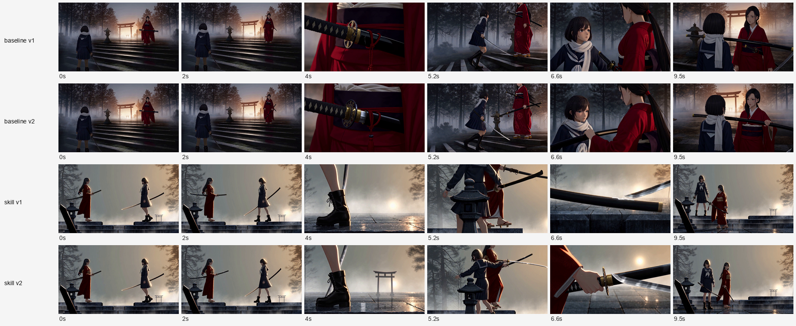

# H3 对比测试：和服 vs 水手服 · 刀

2026-10-24 · MiniMax H3（AutoDL `minimax_h3_zm_u24`）· 10 s / 768p 横 / 16:9

**结论先说：第一轮是基线赢（21 : 19）。** 技能在设计结构上更完整，但在 10 秒、5 镜的执行密度下，它选择的"物件插入"吃掉了因果，反而不如基线的"反应镜头"读得懂。

**第二轮（带预演门重跑）两版都变好了，但基线仍然领先：18 : 16。** 预演把"无主武器 / 无手接触 / 裁头"抓了出来，定向改提示词后，两版的"人—手—柄—刃"链条明显改善；技能版改善 3 分，基线版改善 6 分——基线的底子更干净，补丁只需要修道具，不需要修调度。

## 设置

| 项 | 设置 |
|---|---|
| 简报 | 黄昏废弃神社石阶，和服少女 A（深红留袖、黑漆鞘）与水手服少女 B（藏青水手服、出鞘刀）对峙；一人先动；一次交锋；收势。无对白、无配乐、无血浆、无升格 |
| 条件 | 基线：禁止读技能/参考；技能：加载 `shot-design` 走完整工作流并 `validate --strict` |
| 隔离 | 两个子代理独立设计，互不可见 |
| 提示词 | 两份设计由我统一转成 H3 **Ref2VA 六段式**（`subject_definitions` / `summary` / `retention_analysis` / `detailed_description` / `overall_soundscape` / `non_diegetic_music`），结构相同、只换内容 |
| 首帧 | 各自第 1 镜描述 → NovelAI（**顺序两次调用**，遵守单并发）|
| 生成 | H3 两次，顺序执行，各 10 s / 768p横，输出 10.125 s |

## 两份设计

| | 基线（X） | 技能（Y） |
|---|---|---|
| 镜数 / 总长 | 5 镜 / 10 s | 5 镜 / 10 s |
| 时长 | 3.5 / 1.5 / 2.0 / 1.5 / 1.5 | 2.6 / 2.1 / 1.3 / 1.2 / 2.8 |
| 结构 | 高低对峙 → **鞘口半出（不拔）** → B 先动斜劈 → 鞘卸力 → 鞘尖抵领巾 | M13 对峙 → M05 蓄势 → M06 冲刺 → M07 接触特写 → M21 慢拉换位 |
| 宣告的转折 | 先出手的人被算中 | 先动的 B 交出答案，A 不拔刀 |
| 结尾 | 鞘尖抵 B 领巾下缘 | 位置对调，只留白痕 |
| 校验 | —（无 schema） | `OK 5 shots, 10.0s`，4 个切点 100/100 |

技能侧多做了：节拍表、起/转/终、机制编号、风险与 fallback（点名 S04 接触镜最可能穿模，兜底为"以结果代接触"）。

## 执行：切点基本被遵守

检测每 0.2 s 帧差峰值，对上各自宣告的切点：

| 基线宣告 | 检测峰值 | 偏差 |
|---|---|---|
| 3.50 | 3.40 | 0.10 |
| 5.00 | 4.80 / 5.00 | 0.00–0.20 |
| 7.00 | 6.60 | 0.40 |
| 8.50 | 8.00 | 0.50 |

| 技能宣告 | 检测峰值 | 偏差 |
|---|---|---|
| 2.60 | 2.40 | 0.20 |
| 4.70 | 4.40 | 0.30 |
| 6.00 | 5.60 | 0.40 |
| 7.20 | 6.80 | 0.40 |

结论：**H3 能把 5 个切点都执行出来**，两版都做到了。差异不在"有没有切"，而在每镜里发生了什么。

## 盲评（X/Y 匿名，只看 6 帧/片）

| 维度 | X 基线 | Y 技能 |
|---|---|---|
| 动作因果 | 4 | 3 |
| 空间与轴线 | 3 | 4 |
| 节奏 | 4 | 4 |
| 设计感 | 4 | 3 |
| 主题贴合 | 4 | 3 |
| 一致性/执行 | 2 | 2 |
| **总分 /30** | **21** | **19** |

评委原话（节选）：

- X 的 **6.6 s** 帧把"一击之后"落在 **B 的瞳孔**上，A 只给不看的侧脸——唯一真正拍到"空气变了"的帧。
- Y 的 **6.6 s** 帧是"刀尖点鞘 + 一粒火星"，是两版里最漂亮的图形，**但画面里没有人**。
- Y 的 **5.2 s** 两把黑鞘交叉、两个人的头都被裁掉，因果链在这里断了。
- 两版共同的执行问题：**手—柄—鞘的链条都断了**（多余武器、悬空鞘、刀消失）；共同"每片都塞了一个静物插入"。

## 为什么会这样

1. **技能把峰值交给了物件。** M07"接触特写"在文本上是教科书选择（刀咬鞘、白痕炸开），但 1.2 s 的 H3 镜头里，模型保不住"谁握着什么"，也来不及交代后果。基线把峰值给了**反应**（B 的眼睛），因果由脸承担。
2. **10 秒 5 镜、平均 2 秒，密度到顶。** 技能还想在 S04 放一个 1.2 s 的物证、S05 用 2.8 s 慢拉换位；H3 完成了切点，但 S03 的"固定侧中景"漂成了更近的双人构图，S04 的物证帧与 S05 之间的"白痕 match cut"没有成立。
3. **技能自己写了风险，却没有在选择阶段使用它。** 设计里点名 S04 最可能穿模，并给了"以结果代接触"的兜底——但生成用的提示词仍按 S04 的接触帧写。风险意识没有回流到提示词。
4. **基线的主题贯穿更硬**："刀不出鞘"从 S2 的鞘口微距 → S4 卸力 → S5 抵喉，是一条可累积的动机；技能同样不拔刀，但 S04 的物证替代了人的反应，动机没落到脸上。

## 这次测试改变了技能里的什么

- 新增规则：**接触帧里必须有人**（手或脸），否则下一镜必须补反应；纯物件插入不能占峰值。
- `M07 Impact close` 的失败模式补充："object-only contact frame severs who-hit-whom; pair with M18"。
- `beats.md`：`impact` 节拍默认携带一个反应，而不只是一个接触。
- 版本 0.4.3。

## 为什么这次没有分镜（流程问题，不是模型问题）

这条测试暴露的是**流程被抄了近路**，值得单独记：

1. 我给两个设计代理的指令是"只要设计，不生成图片"，所以它们没有画分镜；
2. 我（测试者）只拿各自第 1 镜的描述出了一张首帧，就直接进了 H3——**跳过了技能的 Step 6（分镜）与 Step 7（animatic）**；
3. 当时的技能把分镜写成"用户要的时候再画"，没有强制，所以这个跳步没有被拦住。

代价正好落在评委指出的地方：**手—柄—鞘的链条断裂**（多余鞘、刀换手、悬空）。这种错误在一张潦草的面板上就能看出，却要在 5 分钟生成之后才发现。

**0.4.4 已改为预演门（previs gate）**：3 镜以上、有手递手、有接触、有左右/高低互换、或超过 8 秒的段落，必须在交给视频模型之前**渲染分镜 + 用 `annotate.py` 标注 + 用 `animatic.py` 拼一条 animatic**。写下 `storyboard` 字段不算通过——那只是"打算画"。故意跳过必须写 `previs_waived` 并给理由。

## 第二轮：带预演门重跑

按 0.4.4 的预演门，先出分镜再生成。10 张灰度面板（5 镜 × 2 版，NovelAI 顺序 10 次），标注 + 拼成每版的联系表，逐镜检查（完整记录见 [previs/review.md](previs/review.md)）。

**预演抓到的问题**（生成前就能看到）：

| 问题 | 位置 |
|---|---|
| 一人身上出现两把刀/鞘 | 技能 S02（3 把）、S03、S04；基线 S04 |
| 持刀手看不见，谁握什么不明 | 技能 S02、S04；基线 S04 |
| 白围巾被拉成连接两人的横幅 | 基线 S05 |
| 图像模型把一格拆成双联（非设计问题） | 多格 |

**改法**：不重画全部分镜，只把约束写进 H3 提示词——每个角色只有一把刀、武器不换手、不出现第三把；接触镜必须见手；S03 保持双人头在框内；围巾只在脖子上。另用收紧后的提示词重画了 3 张最差面板验证约束（技能 S02/S04、基线 S05），确实变成"一手一刃"。

**第二轮结果**（同一盲评口径，v1 vs v2）：

| 组 | 旧版 | 新版 | 变化 |
|---|---|---|---|
| 基线 | 12 / 25 | **18** | +6 |
| 技能 | 13 / 25 | **16** | +3 |

评语要点：

- 基线 9.5 s 从"鞘横在胸前、两手空垂、腰间多一把"变成"单鞘、右手实握"——武器归属修好。
- 技能 6.6 s 从"纯刀鞘特写、无人"变成"手 + 柄 + 镡 + 来袭刀同框"——0.4.3 的接触规则生效。
- **仍然没修干净**：技能 5.2 s 一人两柄、两人的头被顶边切掉；基线 5.2 s 也切头。评委结论是"按约束打补丁，不是重新调度"。
- 两版共有的更深问题：交锋没有受力结果（刀身贴/点鞘身，没有格挡反弹、错身或后退），收势回到起手站姿——"空气变了"仍只靠光。

切点执行两轮一致：检测到的画面突变都落在宣告切点 ±0.5 s 内。



### 这一轮证明了什么

1. **预演门有效，但只对"能写进约束"的问题有效**：多余武器、无手接触、裁头，抓到就能改。
2. **预演门抓不到"调度本身不够好"**：技能版把峰值放在物件特写上，即使补上手，因果仍弱于基线的反应镜头——那是 Step 4 的选择问题，不是 Step 6 的分镜问题。
3. **约束是补丁，不是设计**：5.2 s 的一人两柄说明，1.2–2 s 的近距离镜头里，H3 保不住道具所有权；真正的解法是**避免在这种镜头里让两件武器同时入画**，而不是在提示词里加否定句。

## 局限

- **单样本、单次生成**：H3 的随机性足以让 21:19 翻面。
- **首帧不同**：两版各自出图，基线偏写实、技能偏平面动画，风格差异会进入视频。
- **评委只看 6 张静帧**：动感、声音、切点节奏没有被完整评估；切点数据由脚本单独给出。
- **我转写了提示词**：两份都经同一模板转换，但"设计 → 英文"的转写仍有我的判断。

## 复现材料

```
duel-test/brief.md                简报
duel-test/outputs/baseline.md     基线设计
duel-test/outputs/skill.md        技能设计（skill.json 为镜头卡）
duel-test/baseline-prompt.txt     H3 Ref2VA 提示词（基线）
duel-test/skill-prompt.txt        H3 Ref2VA 提示词（技能）
duel-test/h3/*/output.mp4         两段视频
duel-test/judge/x|y/              盲评帧（X=基线，Y=技能，映射见 mapping.json）
duel-test/judge/verdict.md        评委全文
duel-test/analyze.py              切点检测脚本
```
