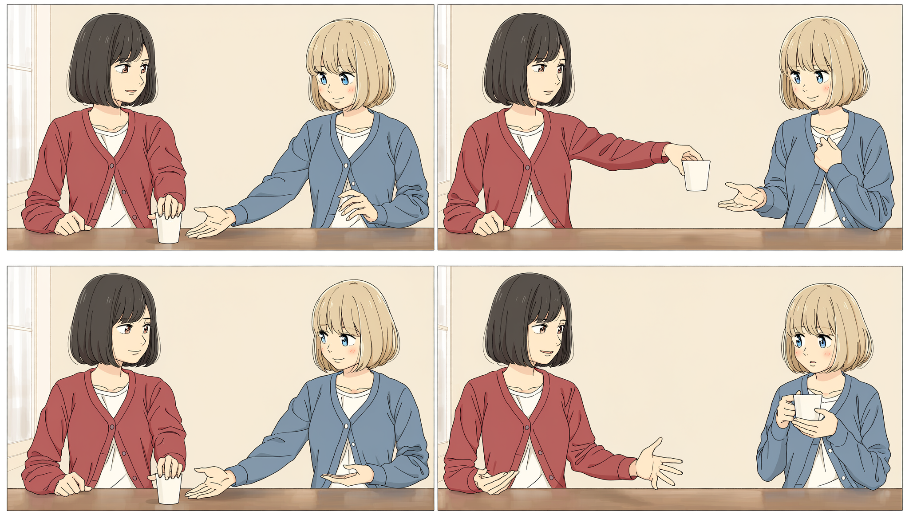
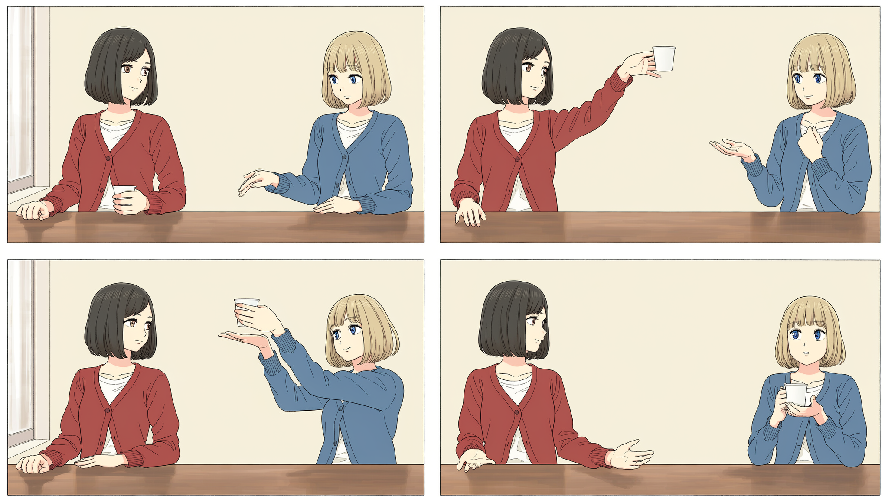
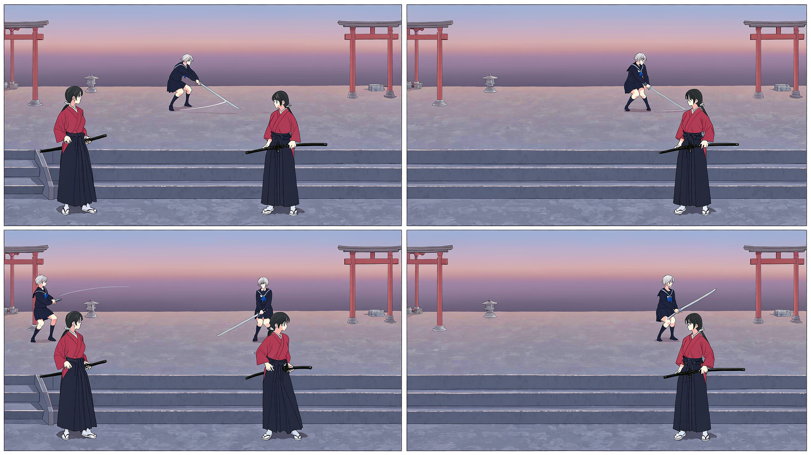

# v0.6 NovelAI 宫格分镜实测

日期：2026-10-25。目标是按用户偏好，把连续状态放在同一次 NovelAI 整页生成中，尽量稳定人物与画风，同时验证基础动作有没有被画出来。

## 结论

四格整页在本次递杯样本中保持了相同人物、服装与绘画方式，且每格只有一只杯；比上一轮逐格生成的这几项结果更整齐。但它仍跳过关键的共同托杯状态。刀战页保留了红／蓝角色造型，却出现重复人物、错误地面高度与错误刀路。**这次完成了生成组织和工具升级，两个动作案例都没有通过完整内容验收。**

这不是受控 A/B：同时改变了组织方式、提示词和分辨率；不能把差异全部归因于宫格。评审由执行者完成，未做独立盲评，不能推广为模型成功率。

## 从参考仓库采用了什么

检查 [novelai_local_web 的当前提示文档](https://github.com/YILING0013/novelai_local_web/blob/a30d510a4f4eece69bed56958e9468196114c95e/docs/comic-prompts-current.zh-CN.md) 与 [comicAI.mjs 的组装实现](https://github.com/YILING0013/novelai_local_web/blob/a30d510a4f4eece69bed56958e9468196114c95e/next_nai_web/src/components/ai-painting/ComicWorkspace/comicAI.mjs)，固定提交 `a30d510a4f4eece69bed56958e9468196114c95e`。

采用三种职责：共享风格与环境在主提示；每格关系和道具状态也进入主提示；每个人每次出场分别生成包含固定外观、当前动作和整页坐标的 character 槽。同一人跨四格出现，占四个出场槽，两人四格共八槽。

该仓库目前更偏好自由漫画版式；本实现按用户选择使用规则宫格。不引入它的强制故事扩写，也没有复制它的源码或完整系统提示。V5 的主提示／角色提示、坐标和容量另与 [NovelAI 官方多角色文档](https://docs.novelai.net/en/image/multiplecharacters/) 对照；整页生成能力见 [V5 发布说明](https://journal.novelai.net/image-generation-novelai-diffusion-v5-is-here-c2df7c6b8d2d/)。

## 实际请求

通过项目已有 `.dsh/skills/novelai-image/scripts/nai.py` 调用，凭据由客户端从 `.env` 内部加载；没有另写 HTTP 客户端，没有启动下载仓库的应用，也没有把密钥交给该仓库。请求逐个执行，失败没有自动重试。

共同参数：`nai-diffusion-5-full`，2048×1152，23 steps，scale 5.5，`k_euler_ancestral` / `karras`，每次一张。每页 2 列×2 行，八个 character 出场槽。单格约 1024×576，实际边框导致大小不完全相同。

| 请求 | seed | 结果 | 观察 |
|---|---:|---|---|
| cup-page | 741092 | 成功 | 四格完整，人物与单杯稳定，共握格仍回到桌面状态 |
| duel-page-1 | 741093 | 失败 | 客户端记录 `network error: [Errno 2] No such file or directory`，无图；未重试 |
| duel-page-2 | 741094 | 成功 | 四格完整，但部分格重复人物、前后景站在不同高度 |
| cup-page-revision-1 | 741092 | 成功 | 补明举杯后确实举起，仍跳过共握，且举得过高 |

合计 4 次尝试、3 张整页成功、12 个绘制画格；0 次新 H3 请求。余额从 16,413 到 16,236，观察到减少 177 Anlas。三张整页不是三份通过的分镜；失败请求的收费无法仅靠余额差单独归因。

输入计划是本目录四份 `*-page*.json`；完整脱敏 API 请求、结果、原图摘要、逐格意见与裁框保存在 [results.json](results.json)。本地原图与裁图在 `artifacts/live-grid-v0.6/`，未纳入 Git。

## 逐页观察

### 递杯初版

读图可认出相同黑发红衣者与金发蓝衣者；每格只有一只杯；墙面、窗户与绘画方式大体稳定。第二格有递出与接触前间隙，第四格可读出乙独自持杯。

第三格杯子却再次靠在桌面，甲没有保持第二格的递出手臂，乙没有完成计划中的共同承托。第一格乙提前伸手，左右手分工也没有准确服从计划。它可以表达大致“把杯子给了对方”，不能作为精确交接动作的完整粗板。

### 递杯定向修改

同 seed 保留为一次具体修改记录，不代表其他变量都相同。修改主提示与第三格角色动作，强调杯子在空中、甲尚未放手、乙掌心接底。

结果第二格与第三格确实举杯，但第二格高于预期胸口位置；第三格变成乙已经单独举杯，甲两手离开，再次跳过共同承托。第一格“乙双手放腿上”也未兑现。人物一致性依旧较好，但动作状态仍不通过。

### 刀战第二页

设计要求双方都在同一平台，甲向摄影机方向侧移一步，乙的刀经过甲原先位置的空位。图中甲多次处于台阶前低处，乙留在上层；第一格出现两个甲，第三格出现两甲两乙。刀路呈斜向，未画出要求的同层水平落空。

这表明 character 坐标与多人槽可以影响画面位置，却不能当作严格的三维调度或人物数量绑定。第一页网络失败，因而也没有完整八格序列用于跨页连续性验收。

## 已落实到 skill

- 入口增加 NovelAI 连续分镜优先考虑四格／六格整页的分支；保留 beat、shot、panel 的区别，不因为宫格增加切点。
- 新增 `references/novelai-pages.md`：主提示／人物提示职责、逐次出场、坐标转换、页尺寸、负面提示冲突、跨页漂移、回看与交接。
- 新增 `scripts/pageboard.py`：本地编译提示和计划布局；可通过 `--sequence` 检查原镜头／画格归属。它不读取密钥、不联网。
- 裁图前记录真实边框和精确原图摘要，保留原图；manifest 保存页／镜头／画格和逐格意见。布局检查通过与内容验收通过分开。
- 修订 storyboard / handoff：允许计划内整页，按实际边框裁图，不能把漫画整页冒充视频首帧。

三张成功页均已打开检查，裁框依据实际线条位置而非直接等分。例如递杯初版竖边约为 x=16/977 与 986/2032，修改版为 x=17/978 与 1015/2029；固定 x=1024 切分会夹入留白或相邻图。

裁出的 12 张图都保留各自内容意见，三份 manifest 的 `all_content_approved` 都是 false。递杯最终所有权格可读，不会因此把整页标为通过。已另保存诊断序列：递杯 1 镜 4 格完整链接；刀战保留 3 镜 8 格，前四格缺图明确记录，没有拿后四格冒充完整八格。

## 验证与下一次修改依据

`selftest.py --verbose`：8 passed、0 failed、0 skipped。新增验证包括每次出场的稳定外观与变化动作、格内到整页坐标、22 槽容量、实际裁图像素、原图未改动、过期摘要／越界／重叠裁框拒绝，以及内容失败不会随布局检查被自动升级为通过。skill 结构校验通过，递杯裁图已接回原一镜四格 JSON，结构／时间／图片检查通过。

v0.6.0 已同步到 `C:/Users/Administrator/.agents/skills/shot-design`，37 个文件逐字节一致，安装目录的 skill 校验通过。v0.5.0 备份及安装摘要保存在 `artifacts/upgrade-v0.6/`。

后续按“整页先统一人物与观看，再修具体失败状态”继续。递杯若要再出图，应优先局部修复第三格的接触关系，并回看相邻两格；刀战应先用更明确的平面调度或姿态草图解决同层刀路，再谈风格。跨页需要明确锚点，但不能声称本次已经验证跨页一致性。与重新逐格从零生成相比，保留已有效的整页人物与场景是这版工作方式的主要改进。
