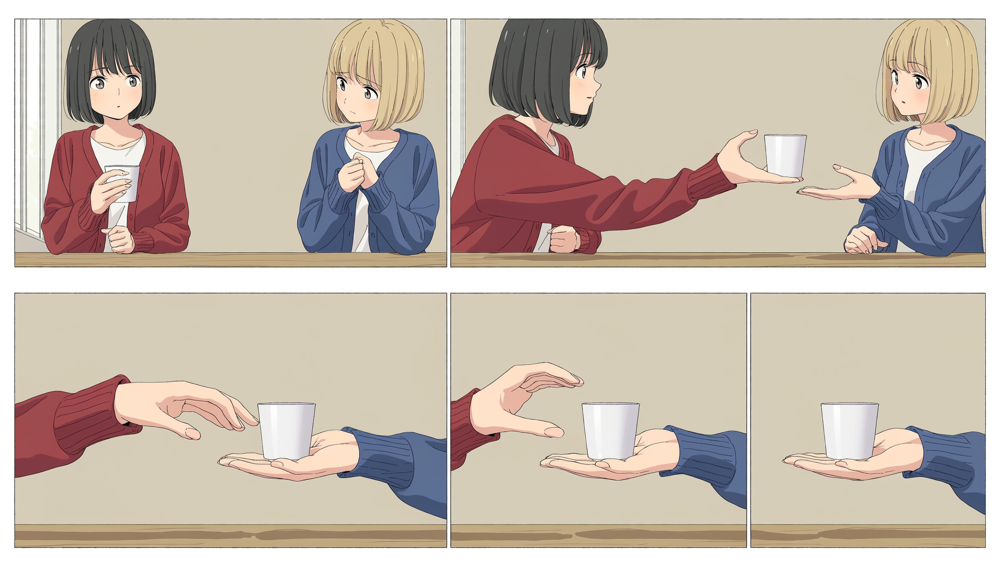
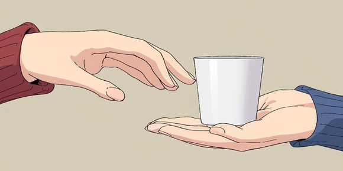
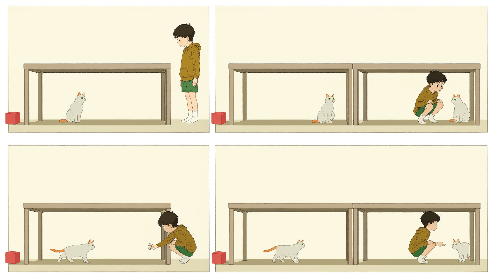
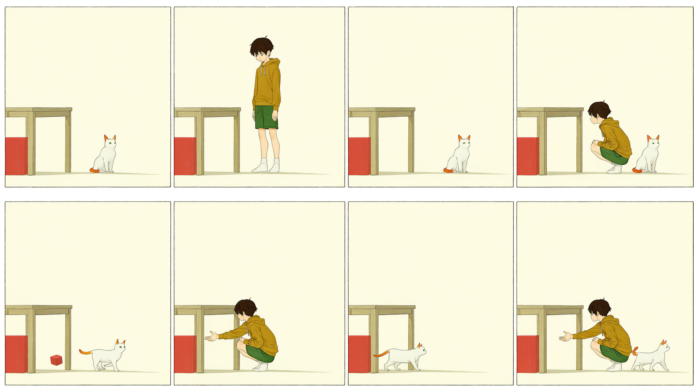

# v0.7 真实分镜复测

日期：2026-10-25。使用收敛后的 skill 和 `.env` 中已有 NovelAI 配置。测试两题，每题一张计划为四格的整页，另允许一次针对性回改。

**结果：两题都未通过内容验收。** 三次接口均成功返回图片，但关键动作、人物数量和版式仍无法稳定兑现。精简完成的是内容组织；本轮没有证明创作效果提升或退步。

## 任务与结果

| 案例 | 本次设计 | 实际结果 |
|---|---|---|
| 递杯 | 2 镜 4 格：双人中景建立与递近，手部近景共同支撑与松手 | 实际 5 格；递近和最终接住可读，共握仍不明确 |
| 小孩与猫 | 1 镜 4 格：发现、蹲下、伸空手、猫向左退 | 外框为 4 格，部分格多出猫和桌子；朝向、机位和退后关系错误 |
| 小孩与猫回改 | 保留 seed 和坐标，缩短主提示与个人动作，减少相互提及 | 实际 8 格，人物和猫多次分开成格；退后仍未成立 |

新题来自已有行为评测题集，此前未在本项目实际生成。没有独立盲评，读图由执行者完成；递杯同时改变观看和支撑方案，不是与旧版的受控 A/B。

## 实图

### 递杯

人物与衣服总体一致，每格一只杯。上排可读出持杯和递近，下排可读出乙承托、甲手移开。关键近景中红袖手张开，指尖可能碰到杯侧，却没有明确保持握杯和支撑；不能据此认定共同承托已画清。

下排实际分成三格，不能将五幅图静默当作计划中的四幅。保留原图和布局偏差记录，没有强行套四格裁图映射。

### 小孩与猫初稿

第一格站立发现可读。第二、四格内部出现两只猫和两张相邻桌子，小孩转向另一只猫；第三格虽伸出空手，猫的姿态与路径未清楚表现退让。最后无法判断同一只猫是否向左远离手，固定机位也未保持。

### 小孩与猫回改

主提示只保留固定场景，动作留给各格，并缩短人物与猫的提示。结果形成两行四列，常将人物和猫分别成格。合框时猫位于小孩另一侧，桌下关系也不成立。八格与八个角色槽数量相同，可能存在出场槽与画格的混淆；单例不足以确认原因。回改后停止生成。

## 执行与文件

- 模型 `nai-diffusion-5-full`；2048×1152，23 steps，scale 5.5，每次一张；每页请求含八个 character 槽，坐标与顺序字段均实际传入。
- 三次请求全部成功，0 次网络重试，0 次 H3 调用。余额 16,236 → 16,059，观察到消耗 **177 Anlas**。
- 输入、seed、skill 摘要、实际请求与逐格评审见本目录 JSON，汇总为 [results.json](results.json)。图片保存在 `artifacts/live-v0.7/`。
- 小孩与猫初稿外框为四格，按实际边框裁出四张诊断图；manifest 的内容批准结果为 false。递杯与回改页的实际格数不同于计划，未强行映射。
- 已生成 失败诊断播放（视频为本地产物，未随仓库发布；见下方检查帧与执行记录）：6 秒、144 帧、1 镜 4 格，无缺图占位，EDL 归属正确。时间为临时检查值，不是通过验收的表演定时。
- 离线回归 **8 passed / 0 failed / 0 skipped**。本轮没有修改 skill 或追加规则。

本次可确认输入组装、接口、裁图和播放链路能运行；当前方案的动作与版式执行仍不可靠。下一步若继续迭代，应把“一个目标画格里两次出场能否稳定共框”和“关键接触姿态能否画清”分开检验，而不是直接增加整页叙事复杂度。
